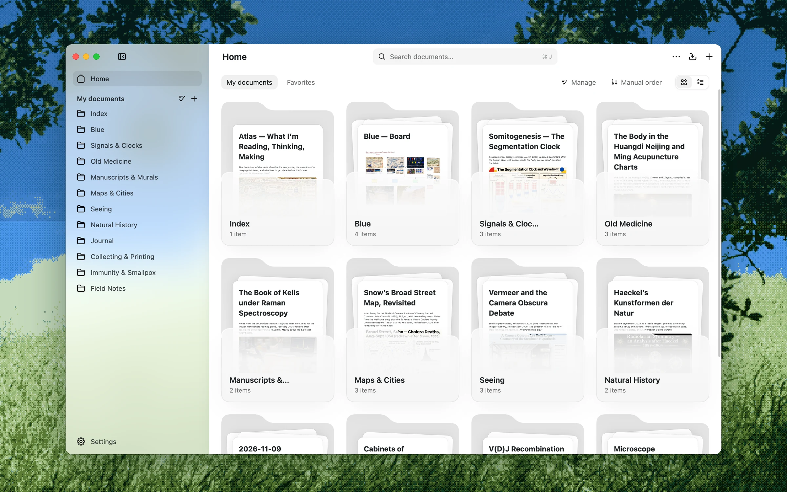
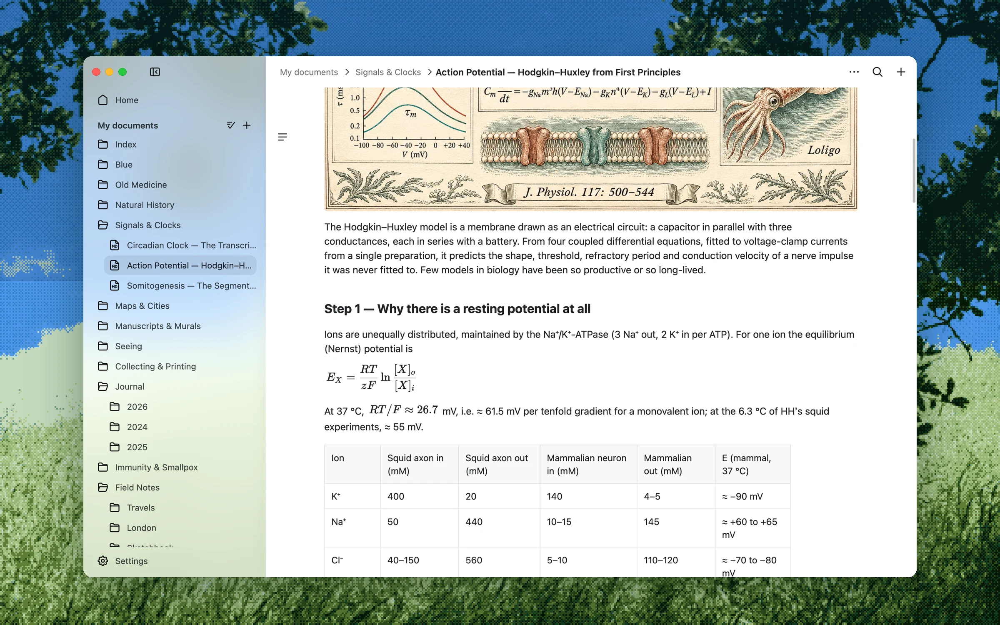
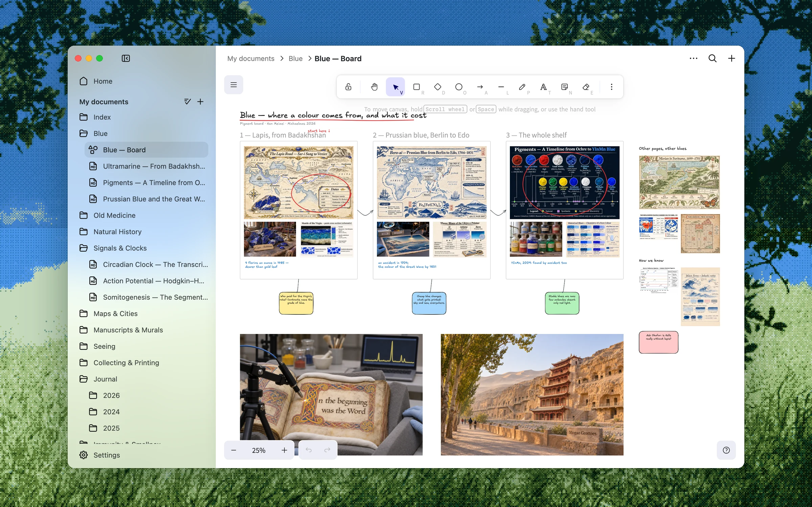
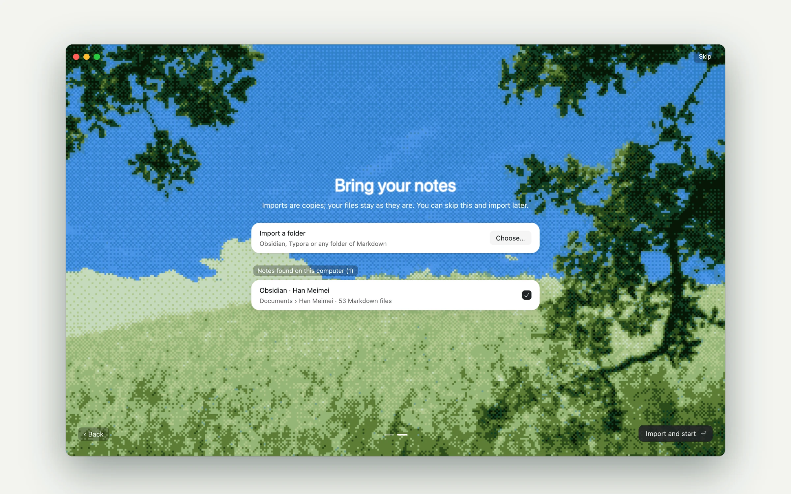

<h1 align="center">Quiet.md</h1>

  <b>速くて静かな、あなたのコンピューターに置くノート。</b> 
  Rust + GPUI でネイティブに描画するノートアプリです。本物のフォルダ、入力するそばから整う Markdown、そしてノートの中のホワイトボード。無料のオープンソースです。

  <a href="README.md">English</a> · <a href="README.zh-CN.md">简体中文</a> · <a href="README.zh-TW.md">繁體中文</a> · 日本語 · <a href="README.ko.md">한국어</a> · <a href="README.es.md">Español</a> · <a href="README.fr.md">Français</a>

  
  
  
  
  
  

  
  &nbsp;
  
  &nbsp;
  

  <a href="https://quiet.md/?lang=en"><b>Web サイト</b></a> ·
  <a href="#ダウンロード"><b>ダウンロード</b></a> ·
  <a href="#機能">機能</a> ·
  <a href="#パフォーマンス">パフォーマンス</a> ·
  <a href="CONTRIBUTING.md">コントリビュート</a>

  

> [!NOTE]
> Quiet.md は**ベータ版**で、急速に変化しています。バグを見つけたり、アイデアがあったりしたら、[issue を作成](https://github.com/s1dashu/quiet-md/issues)してください。プルリクエストを送ってもらえると、もっとうれしいです。

## Quiet.md を選ぶ理由

**📁 ノートはただのファイル。** アカウントもクラウドも不要で、既定ではネットワークに何も送りません（任意のアップデート確認と、ホワイトボードで初めて中国語・日本語・韓国語の手書きフォントが必要になったとき、またはダウンロード可能なドキュメントフォントを選んだときのフォントのダウンロードを除く）。サイドバーのフォルダはどれもディスク上の本物のフォルダで、ノートはそれぞれタイトル名のファイルです。Markdown は `.md`、リッチなドキュメントは `.xml`。iCloud でも Git でも、好きな方法で同期できます。Quiet.md を使わなくなっても、ファイルはそのまま残ります。

**⚡ ネイティブで、速い。** インターフェース全体を Rust と [GPUI](https://www.gpui.rs/) が GPU で描画します。Electron も WebView も使いません。100 万文字のノートでも、入力は 1 フレームあたり約 5 ms。120 Hz のディスプレイが 1 フレームに使える時間は 8.3 ms です。

**✍️ 書くことと描くことを、ひとつの場所で。** `#`、`-`、`[]`、`>` と打てば Markdown がその場で整います。言葉で足りないときは、ノートにそのままホワイトボードを置けます。リッチなノートは Feishu（Lark）の DocxXML 形式で保存されるので、Feishu や Web ページから貼り付けても構造が保たれます。

## 機能

### 書く

  

見出し、リスト、ToDo、引用、コールアウト、段組み、セル結合できる表、シンタックスハイライト付きのコード、LaTeX 数式、画像、ファイル、カバー。書きながら Markdown のショートカットが使え、それ以外は `/` メニューにあります。別のノートをメンションするとリンクになり、相手のノートにはバックリンクが表示されます。

### 描く

  

ボードは Excalidraw から移植したホワイトボードです。図形、つながったままの矢印、フリーハンド、テキスト、付箋、フレーム、画像。ノートの中に置くことも、excalidraw.com で開ける `.excalidraw` ファイルとして保存することもできます。トラックパッドのピンチでズームでき、10,000 個の図形があってもなめらかに動きます。

### 本物のフォルダで整理する

ホームでは、各フォルダが中身の見える紙の束として並びます。ノートをフォルダの上でしばらく止めるとフォルダが開き、フォルダの中にさらにフォルダを入れられます。移動は取り消せます。ノートはピン留めやお気に入りができ、`⌘ J` ですべてのタイトルと本文を検索、ノート内では検索と置換ができ、正規表現も使えます。削除したノートはまずゴミ箱へ。コンピューター上のほかの場所にある Markdown ファイルやフォルダは、「このコンピュータのファイル」で開いてその場で編集できます。

### ノートを連れてくる

  

初回起動時に、Quiet.md は Obsidian、Logseq、iA Writer、Typora のライブラリを探してコピーします。元のファイルには手を触れません。Obsidian の `[[ウィキリンク]]` もそのまま使え、クリックするとリンク先のノートが開きます。あとからでも、Markdown ファイルやフォルダをホームに、あるいはサイドバーのフォルダに直接ドラッグできます。ノートは Markdown や PDF に書き出すことも、そのまま印刷することもできます。

### ほかにも

- **バージョン履歴**：ノートは保存のたびにスナップショットを残します（既定で 20 件、最大 30 件）。開くと変更箇所がその場でわかり、ワンクリックで復元でき、名前も付けられます。
- **クイックノート**：macOS では、グローバルショートカット（既定は `⌥ Space`）でどのアプリの上にも小さなノートウィンドウを開けます。
- **見た目**：Craft、Feishu、Notion、Obsidian の 4 つの組み込みスタイルに、それぞれダークモード付き。CSS で自作もできます（[docs/THEMES.md](docs/THEMES.md)）。インターフェースとドキュメントのフォントも選べます。
- **キー**：`⌘ /` ですべてのショートカットを表示でき、どれでも割り当てを変えられます。Windows と Linux では ⌘ の代わりに Ctrl、⌥ の代わりに Alt を使います。
- **言語**：英語、簡体字中国語、繁体字中国語、日本語、韓国語、スペイン語、フランス語、アラビア語、トルコ語。アラビア語は文字がつながり、右から左に表示されます。
- **お掃除**：「設定 › ライブラリ」で、どのノートにも使われなくなった画像やファイルを見つけ、確認してから移動します。
- **アップデート**：新しいバージョンは署名を検証したうえでアプリ内からインストールされます。自動確認はオフにできます。

## ダウンロード

  
  &nbsp;
  
  &nbsp;
  

| プラットフォーム | パッケージ | 要件 |
|---|---|---|
| **macOS**（Apple シリコン） | [quiet-md-macos-arm64.dmg](https://download.quiet.md/latest/quiet-md-macos-arm64.dmg) | macOS 13 以降 |
| **Windows**（x64） | [quiet-md-windows-x64-setup.exe](https://download.quiet.md/latest/quiet-md-windows-x64-setup.exe) | Windows 10 バージョン 1809 以降 |
| **Linux**（x86_64、試験的） | [quiet-md-x86_64.AppImage](https://download.quiet.md/latest/quiet-md-x86_64.AppImage) | glibc 2.35 以降（Ubuntu 22.04 以降） |
| **macOS**（Intel） | [quiet-md-macos-x86_64.dmg](https://download.quiet.md/latest/quiet-md-macos-x86_64.dmg) | macOS 13 以降 |

- **macOS**: `.dmg` を開き、`quiet.md.app` を隣の「アプリケーション」へのショートカットにドラッグして、アプリケーションフォルダーから開きます。アプリとディスクイメージは Apple によって署名・公証されています。Releases ページの `.zip` は同じアプリで、アプリ内アップデートがダウンロードするものです。
- **Windows**: インストーラーを実行します。デフォルトでは現在のユーザーだけにインストールされ、アンインストールしてもノートが削除されることはありません。初回の起動時に SmartScreen が表示された場合は、**詳細情報 → 実行** をクリックしてください。
- **Linux**（試験的）: `chmod +x quiet-md-*.AppImage` を実行してから起動します。FUSE がない場合は `--appimage-extract-and-run` を付けてください。AppImage 0.1.10 以降はアプリ内更新に対応します。以前の Linux 版からは一度手動でインストールしてください。現在の対話的なテストは Wayland 上の Omarchy のみです。詳しくは [Linux の説明](CONTRIBUTING.md#linux-experimental)を参照してください。

[Quiet.md](https://quiet.md/?lang=en) からもダウンロードできます。すべてのリリースとその SHA-256 チェックサムは [GitHub Releases](https://github.com/s1dashu/quiet-md/releases) にあります。

初回の起動時に、表示言語、ライブラリの場所、クイックノートのショートカットを選び、Obsidian、Logseq、iA Writer、Typora のノートをコピーして取り込めます。空のライブラリには **Getting started** ガイドが入ります。主な機能を 10 分で紹介するツアーです。既存のノートが上書きされることはありません。

## パフォーマンス

**100 万文字**、549 章の混在したドキュメントで、100 回連続して操作したときのフレームの処理時間：

| 操作 | P50 | P95 |
|---|---:|---:|
| ⌨️ 入力 | **5.06 ms** | 5.78 ms |
| ⌫ Backspace | **4.99 ms** | 5.55 ms |
| 🖱️ スクロール | **2.08 ms** | 4.14 ms |

120 Hz のディスプレイでは、1 フレームに 8.3 ms が与えられます。100 万文字のドキュメントの P95 でも、まだ余裕があります。

| | |
|---|---|
| macOS 版のダウンロード | 約 18 MB |
| Windows 版のインストーラー | 約 14 MB |
| ランタイム | WebView なし、Electron なし、バックグラウンドサービスなし |

Apple M5 Pro / 48 GiB、macOS 26.5、リリースビルド。測定方法と再現用のスクリプト：[docs/PERFORMANCE.md](docs/PERFORMANCE.md)。

## コントリビューター

Quiet.md の開発に協力してくださったすべての方に感謝します。issue とプルリクエストを歓迎します。ビルド、テスト、コードの規約については [CONTRIBUTING.md](CONTRIBUTING.md) をご覧ください。

## 最近の更新

- **0.1.14**（11 月 22 日）: 検索と置換で正規表現が使えるように。Obsidian の `[[ウィキリンク]]` からリンク先のノートを開けます。トルコ語のインターフェースを追加し、アラビア語は右から左に表示。インターフェースと書類のフォントを選べるようになり、どのノートも使っていない画像やファイルを整理できます。ノートが多くても検索が重くならず、まとめて削除するのも速くなりました。「バックスペースでタイトルに戻る」設定を追加。Windows と Linux では「Markdown としてコピー」が Ctrl+Shift+M になりました。
- **0.1.13**（11 月 17 日）: ボードを追加。Excalidraw から移植したホワイトボードで、ノートの中にも、`.excalidraw` ファイルとしても使え、1 万個の図形でも滑らかです。すべてのノートにバージョン履歴（… › バージョン履歴）。フランス語とアラビア語の表示。Markdown としてコピー、ファイルパスのコピー、設定からのライブラリ フォルダーの変更。Web から貼り付けた画像はライブラリに保存されます。画像の多いページのメモリ使用量とサイドバーのスクロールも改善しました。
- **0.1.12**（11 月 14 日）: Finder や「このコンピューターのファイル」から、サイドバーのフォルダーや行のあいだへ直接ドラッグして取り込めるように。ドラッグ中はページ全体がドロップ先になります。ホームのカードを連続曲線の角に刷新、「Finder で開く」を追加、パンくずは「マイドキュメント」から始まり、ウィンドウの最小幅はノートの領域を確保、フルスクリーンではサイドバーが不透明に。フォルダー内で書類を作成すると固まることがある問題を修正。
- **0.1.11**（11 月 13 日）: ライブラリが本物のフォルダーになり、ファイルはタイトルで名前が付きます。以前のライブラリはバックアップを取ってから自動で移行します。表示言語・ライブラリの場所・クイックノートのショートカットを設定し、Obsidian などの Markdown アプリからノートを取り込める新しい初回起動。日本語・スペイン語・韓国語の表示、Markdown のディスプレイ数式、前回の読む位置への復帰、より速い起動と少ないメモリー使用量。
- **0.1.10**（11 月 10 日）: 新規作成メニューで文書形式を選択、幅の広い表の横スクロール、Markdown 表の列揃えの保存、長い入力欄でのカーソル追従に対応。
- **0.1.9**（11 月 8 日）: macOS の Cmd+Q で終了できない問題、Windows のウィンドウ操作ボタンが反応しない問題、背景色付きテキストの選択範囲が見えない問題を修正。
- **0.1.8**（11 月 9 日）: ローカル Markdown の直接編集、`.md` を保持するフォルダーのインポート、階層フォルダーとドラッグ操作・取り消しに対応。画像とプレビューのメモリ使用量を削減し、表の列幅変更とメニューを改善。初回起動時は対応するシステム言語を選択。実験的な Linux AppImage パッケージを追加。
- **0.1.7**（11 月 6 日）: 複数ウインドウの保存、競合からの復元、ファイルへの書き込みを改善しました。エクスポート時に読み取れるファイルの範囲を制限し、Markdown のインライン添付ファイルを保持します。Windows の小狼毫（Weasel）入力時に文字が削除される問題を修正しました。
- **0.1.6**（11 月 6 日）: ウインドウ切り替えと入力を改善し、表の最大幅を広げました。連続入力中も定期的に保存します。macOS では Option+Space でクイックノートを開けます。Windows では画像の貼り付け、PDF エクスポート、印刷に対応し、単語削除の動作を修正しました。
- **0.1.5**（11 月 5 日）: アプリの名前が Quiet.md になりました。ライブラリとノートは元の場所のままです。
  - Home から複数のドキュメントをまとめて管理できます。まとめて複製、移動、削除できます。
  - ゴミ箱を 1 回の操作で空にできます。矢印キーで挿入メニューのアイコンの間を移動できます。すべてのドキュメントを削除しても、空のドキュメントが作られなくなりました。
  - アプリ内で更新した後、新しいバージョンでの変更点がサイドバーに 1 回表示されます。
  - Windows: ショートカットと内蔵のガイドが Ctrl / Alt の表記になり、起動に失敗したときは理由を説明してログを残すようになりました。
- **0.1.4**（11 月 5 日）:
  - アプリ内での更新: 新しいバージョンが出ると、サイドバーの上部に **Update** ボタンが表示されます。ダウンロードは署名で検証され、再起動するとインストールが完了します。開いているドキュメントは先に保存されます。自動チェックは **Settings › General** でオフにできます。チェックはバージョンのマニフェストを取得するだけで、データは何も送信しません。バージョン 0.1.3 以前では、0.1.4 を一度だけ手動でダウンロードする必要があります。
  - ダークモード: **Settings › Appearance** で System、Light、Dark を選べます。内蔵のテーマもカスタムのテーマも、すべてダークの見た目を持ちます。エクスポートと印刷はライトのままです。
- **0.1.3**（11 月 4 日）: macOS がダークモードのときも、サイドバーの文字が読めるようになりました。
- **0.1.2**（11 月 4 日）: macOS の標準のメニューとショートカット（Hide、Minimize、Zoom、Full Screen）に対応しました。最後のウインドウを閉じた後でも、Dock のアイコンをクリックするとウインドウが再び開きます。一部の中国語の文字が誤った字形で表示される問題を修正しました。
- **0.1.1**（11 月 3 日）: 初めての Windows x64 版のリリースです。ユーザーごとにインストールされ、アンインストールしてもノートは残ります。中国語と英語のインターフェースと、内蔵のガイドを磨き上げました。

各バージョンの詳しいリリースノートは [Releases](https://github.com/s1dashu/quiet-md/releases) にあります。

## ライセンス

コードは [MIT](LICENSE) のもとでライセンスされています。サードパーティーのコード、フォント、アセットは [THIRD_PARTY.md](THIRD_PARTY.md) に記載しています。

次のものは MIT ライセンスの対象外で、フォークでは置き換える必要があります。

- `assets/icons/` の 71 個と `assets/editor-icons/` の 23 個の Nucleo アイコンは、Nucleo の商用ライセンスのもとにあります。単独で取り出したり再配布したりしないでください。
- 「Quiet.md」という名前と、アプリのアイコン。
