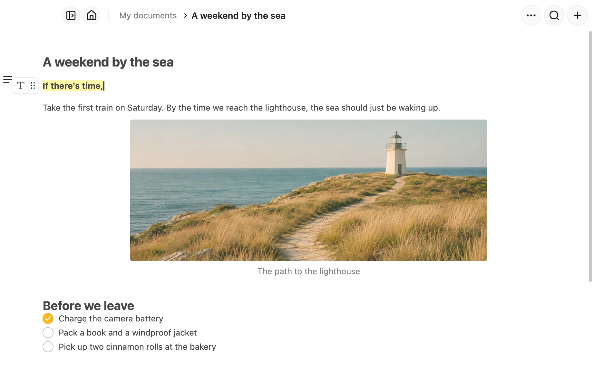

# Fei Notes

A native Markdown document app for Mac, iPhone, and iPad. The ease of Lark Docs, even offline. Turn on iCloud to pick up on another device, as you would in Apple Notes, and edit together in real time.

[Website](https://feinotes.app/) · [Try TestFlight](https://feinotes.app/#testflight) · [Support](https://feinotes.app/support/) · [简体中文](README.zh-CN.md)



- **Local documents.** Write offline, organize documents in folders, search, and back up your library.
- **Optional iCloud sync.** Sync documents, folders and attachments across your Macs, iPhone and iPad. Offline edits to different parts of the same paragraph merge when devices reconnect.
- **Real-time collaboration.** Invite people to view a document or edit it together. Manage who has access from the app.
- **Markdown and rich content.** Use headings, lists, code, tables, images and attachments in a native block editor.
- **Boards.** Add Excalidraw drawings inside documents or create a standalone board, with local history and library backups.
- **Import Quiet.md libraries.** Copy an existing library into Fei Notes through library settings.

## Try the app

The macOS distribution builds a universal app for Apple silicon and Intel Macs running macOS 14 or later. Intel support is compiled and packaged, but has not been tested on Intel hardware. Join through the [website's TestFlight section](https://feinotes.app/#testflight), which shows the current availability and review status.

The iPhone and iPad build targets iOS 17 or later. Its TestFlight availability is listed separately on the website. Mobile build instructions are in [packaging/ios/README.md](packaging/ios/README.md).

## Source and development

Fei Notes is built with Rust, GPUI, SQLite and Loro. Swift bridges integrate CloudKit and StoreKit. The document engine lives in `crates/core`; the root crate contains the shared editor and desktop app. `packaging/ios` provides the native UIKit host and pinned mobile backend.

You can build the local editor from the published source for personal, noncommercial use:

```sh
cargo build --release --locked
scripts/check.sh
scripts/check-cloud-sync.sh  # macOS cloud build and local regression checks
```

The pinned Rust toolchain is in `rust-toolchain.toml`. macOS builds require Xcode. Live CloudKit access requires your own container and signing configuration. See [CONTRIBUTING.md](CONTRIBUTING.md) / [Fei Notes additions](docs/FEINOTES-CONTRIBUTING.md), [AGENTS.md](AGENTS.md) / [Fei Notes rules](docs/FEINOTES-AGENTS.md), [maintenance](docs/MAINTENANCE.md) and [Apple releases](docs/APPLE-RELEASE.md).

The `product/quiet-sync` branch is the Fei Notes product branch. `main` tracks upstream Quiet.md. Generic fixes can be proposed upstream independently.

## Attribution and licensing

Fei Notes is based on [Quiet.md](https://github.com/s1dashu/quiet-md). Upstream code retains its [MIT license](LICENSE). The source is public and you may build it yourself under the applicable licenses. Selected independently authored Fei Notes modules are source-available under [PolyForm Noncommercial 1.0.0](LICENSE-FEINOTES.md), with commercial rights reserved. Commercial use of those modules requires separate permission; this restriction does not change the upstream MIT permissions. File-level scope and third-party exceptions are documented in [LICENSES.md](LICENSES.md) and [THIRD_PARTY.md](THIRD_PARTY.md).
