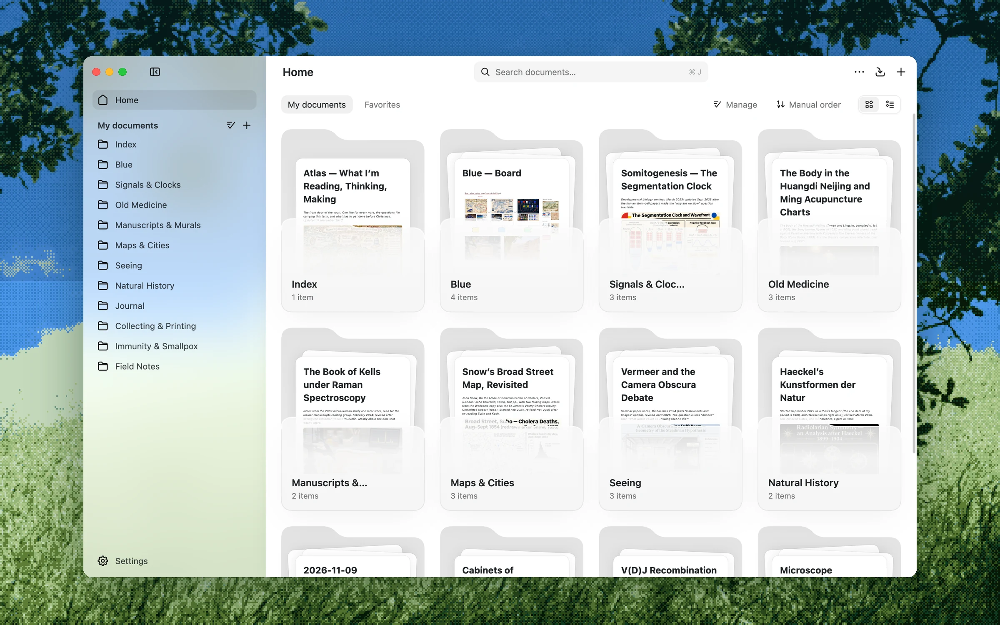
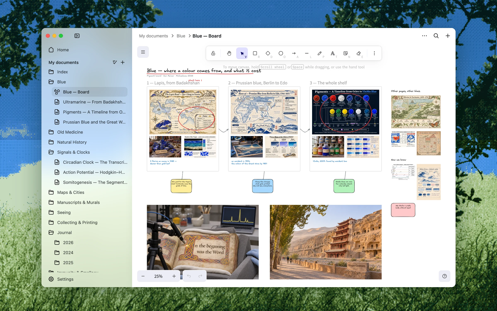
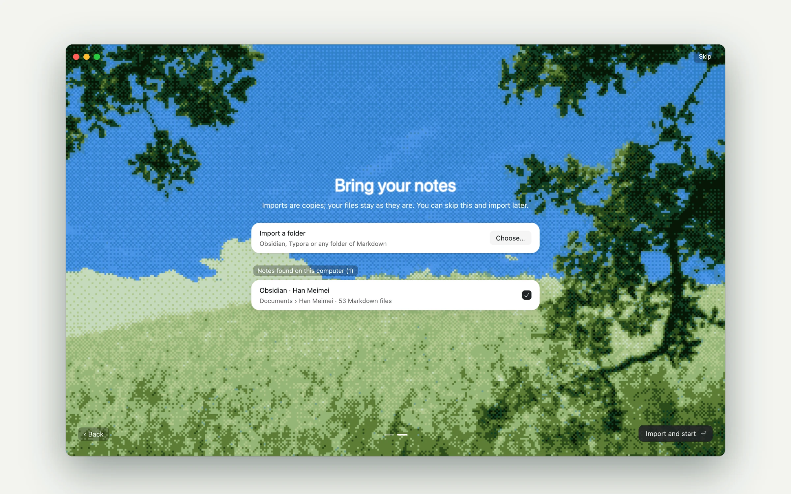

<h1 align="center">Quiet.md</h1>

  <b>又快又安静的笔记，就放在你自己的电脑上。</b> 
  用 Rust + GPUI 原生绘制的笔记应用：真实的文件夹，敲下 Markdown 自动排版，笔记里还有一块白板。免费开源。

  <a href="README.md">English</a> · 简体中文 · <a href="README.zh-TW.md">繁體中文</a> · <a href="README.ja.md">日本語</a> · <a href="README.ko.md">한국어</a> · <a href="README.es.md">Español</a> · <a href="README.fr.md">Français</a>

  
  
  
  
  
  

  
  &nbsp;
  
  &nbsp;
  

  <a href="https://quiet.md"><b>官网</b></a> ·
  <a href="#下载"><b>下载</b></a> ·
  <a href="#功能">功能</a> ·
  <a href="#性能">性能</a> ·
  <a href="CONTRIBUTING.md">参与开发</a>

  

> [!NOTE]
> Quiet.md 目前是 **Beta 版本**，还在快速迭代。遇到 bug 或有想法，欢迎[提 issue](https://github.com/s1dashu/quiet-md/issues)，更欢迎直接提 PR，一起把它打磨好。

## 为什么是 Quiet.md

**📁 笔记就是普通文件。** 没有账号，没有云端，默认不联网（可选的更新检查除外；白板第一次用到中日韩手写字体、或者你选择可下载的文档字体时，会下载对应的字体文件）。侧栏里的每个文件夹都是磁盘上真实的文件夹，每篇笔记都是一个以标题命名的文件：Markdown 是 `.md`，富文本文档是 `.xml`。用 iCloud、Git 或任何同步工具都行；哪天不用 Quiet.md 了，文件也还在原地。

**⚡ 原生，而且快。** 整个界面由 Rust 和 [GPUI](https://www.gpui.rs/) 直接用 GPU 绘制，不是 Electron，也不是网页套壳。在一篇 100 万字的笔记里打字，每帧约 5 ms；120 Hz 屏幕给每帧的时间是 8.3 ms。

**✍️ 写字和画图，在同一个地方。** 敲 `#`、`-`、`[]` 或 `>`，Markdown 自动排好版。文字说不清的时候，直接在笔记里放一块白板。富文本笔记以飞书文档的 DocxXML 格式保存，从飞书或网页粘贴都能保留结构。

## 功能

### 写

  

标题、列表、待办、引用、高亮块、分栏、可合并单元格的表格、带语法高亮的代码、LaTeX 公式、图片、附件和封面。边写边用 Markdown 快捷输入，其余的都在 `/` 菜单里。提及另一篇笔记就能链接过去，对方会列出反向引用。

### 画

  

画板是按 Excalidraw 移植的白板：图形、始终连着的箭头、画笔、文字、便签、分区和图片。可以放进笔记里，也可以存成独立的 `.excalidraw` 文件，excalidraw.com 能直接打开。触控板双指捏合就能缩放；一万个图形的画板依然流畅。

### 用真实的文件夹整理

主页把每个文件夹显示成一叠纸，里面有什么一眼就能看到。把笔记拖到文件夹上停一下，文件夹会自己展开；文件夹里还能再放文件夹，移动可以撤销。笔记可以置顶、收藏；按 `⌘ J` 搜索所有标题和正文，在笔记里查找替换，也可以用正则表达式。删掉的笔记先进回收站。电脑上其他位置的 Markdown 文件和文件夹，可以在「本机文件」里打开，原地编辑。

### 带上旧笔记

  

第一次打开时，Quiet.md 会找到你的 Obsidian、Logseq、iA Writer 和 Typora 笔记库并复制进来，原文件不会被改动。Obsidian 的 `[[双链]]` 照样能用，点一下就打开它指向的笔记。之后也可以把 Markdown 文件和文件夹拖到主页，或者直接拖进侧栏的某个文件夹。笔记也能导出成 Markdown 或 PDF，或者直接打印。

### 还有

- **版本历史**：每篇笔记保存时都会留下快照（默认 20 份，最多 30 份）。点开一份就在原处看到改了什么，一键恢复，也可以给它起个名字。
- **快速笔记**：在 macOS 上，全局快捷键（默认 `⌥ Space`）在任何应用上方打开一个小笔记窗口。
- **外观**：内置 Craft、飞书、Notion、Obsidian 四种风格，每种都有由它的配色推算出的深色效果，也可以用 CSS 自己写（见 [docs/THEMES.md](docs/THEMES.md)）。界面字体和文档字体都能选。
- **快捷键**：按 `⌘ /` 查看全部快捷键，每一个都能改。在 Windows 和 Linux 上，Ctrl 代替 ⌘，Alt 代替 ⌥。
- **语言**：英文、简体中文、繁体中文、日文、韩文、西班牙文、法文、阿拉伯文和土耳其文。阿拉伯文正确连写，从右往左排。
- **清理**：「设置 › 文档库」能找出已经没有笔记在用的图片和文件，确认后才移出。
- **更新**：新版本在应用内安装，安装前会校验签名。自动检查可以关闭。

## 下载

  
  &nbsp;
  
  &nbsp;
  

| 平台 | 安装包 | 系统要求 |
|---|---|---|
| **macOS**（Apple Silicon） | [quiet-md-macos-arm64.dmg](https://download.quiet.md/latest/quiet-md-macos-arm64.dmg) | macOS 13 及以上 |
| **Windows**（x64） | [quiet-md-windows-x64-setup.exe](https://download.quiet.md/latest/quiet-md-windows-x64-setup.exe) | Windows 10 1809 及以上 |
| **Linux**（x86_64，实验性） | [quiet-md-x86_64.AppImage](https://download.quiet.md/latest/quiet-md-x86_64.AppImage) | glibc 2.35 及以上（Ubuntu 22.04 及更新） |
| **macOS**（Intel） | [quiet-md-macos-x86_64.dmg](https://download.quiet.md/latest/quiet-md-macos-x86_64.dmg) | macOS 13 及以上 |

- **macOS**：打开 `.dmg`，把 `quiet.md.app` 拖到旁边的「应用程序」快捷方式上，再从「应用程序」打开。应用和磁盘映像都已签名并通过 Apple 公证。Releases 页面上的 `.zip` 是同一个应用，供应用内更新下载。
- **Windows**：运行安装程序，默认只装到当前用户目录，卸载不会删除笔记。如果首次运行出现 SmartScreen 提示，点「更多信息 → 仍要运行」即可。
- **Linux**（实验性）：`chmod +x quiet-md-*.AppImage` 后直接运行；没有 FUSE 时加 `--appimage-extract-and-run`。AppImage 从 0.1.10 起支持应用内更新；更早的 Linux 版本需先手动安装本版。目前只在 Omarchy（Wayland）上做过交互测试，详见 [Linux 说明](CONTRIBUTING.md#linux-experimental)。

也可以在官网 [Quiet.md](https://quiet.md) 下载。所有版本和 SHA-256 校验值见 [GitHub Releases](https://github.com/s1dashu/quiet-md/releases)。

首次启动时可以选择界面语言、文档库位置和随手记快捷键，并可从 Obsidian、Logseq、iA Writer、Typora 复制已有笔记进来。空文档库里会放一套「开始指南」，十分钟带你过一遍主要功能；已有的笔记不会被覆盖。

## 性能

在一篇 **100 万字**、549 章的混合文档里连续操作 100 次，统计每帧处理耗时：

| 操作 | P50 | P95 |
|---|---:|---:|
| ⌨️ 连续输入 | **5.06 ms** | 5.78 ms |
| ⌫ 连续退格 | **4.99 ms** | 5.55 ms |
| 🖱️ 连续滚动 | **2.08 ms** | 4.14 ms |

120 Hz 屏幕每帧的预算是 8.3 ms，百万字文档下的 P95 也留有余量。

| | |
|---|---|
| macOS 安装包 | 约 18 MB |
| Windows 安装包 | 约 14 MB |
| 运行时 | 无 WebView、无 Electron、无后台服务 |

Apple M5 Pro / 48 GiB，macOS 26.5，Release 构建。测试方法和复现脚本见 [docs/PERFORMANCE.md](docs/PERFORMANCE.md)。

## 贡献者

感谢每一位参与 Quiet.md 的人。欢迎提 issue 和 PR，构建、测试和代码约定见 [CONTRIBUTING.md](CONTRIBUTING.md)。

## 近期更新

- **0.1.14**（11 月 22 日）：查找替换支持正则表达式。Obsidian 的 `[[双链]]` 可以点击跳转。新增土耳其语界面，阿拉伯语从右往左排版。可以选择界面字体和文档字体，清理没有笔记用到的图片和文件。文档很多时搜索不再卡顿，批量删除更快。新增「退格键回到标题」开关；Windows 和 Linux 上「复制为 Markdown」改为 Ctrl+Shift+M。
- **0.1.13**（11 月 17 日）：新增画板，按 Excalidraw 源码移植，可以插在文档里，也可以直接打开 `.excalidraw` 文件，一万个图形也流畅；每篇文档都有版本历史（「…」›「版本历史」）；新增法语和阿拉伯语界面；可以复制为 Markdown、复制文件路径，并在设置里更换文档库文件夹；从网页粘贴的图片会存进文档库。大图页面更省内存，侧栏滚动更顺。
- **0.1.12**（11 月 14 日）：可以把文件从访达、或从「本机文件」直接拖进侧栏的文件夹或两行之间，拖入时整个页面都是放置区；主页卡片改为连续圆角；新增「在访达中打开」；面包屑从「我的文档」开始；窗口最小宽度给文档区留足空间；全屏时侧栏用不透明底色。修复在文件夹里新建文档时可能卡死的问题。
- **0.1.11**（11 月 13 日）：文档库改为真实文件夹，文件以标题命名，旧文档库自动迁移并留有备份；全新的首次启动，可设置语言、文档库位置和随手记快捷键，并从 Obsidian 等 Markdown 应用导入笔记；新增日语、西班牙语和韩语界面；Markdown 支持块级公式；文档回到上次的阅读位置；启动更快、内存更省。
- **0.1.10**（11 月 10 日）：新建菜单可选择文档类型，宽表格支持横向滚动，Markdown 表格保存列对齐，长输入框跟随光标滚动。
- **0.1.9**（11 月 8 日）：修复 macOS ⌘Q 无法退出、Windows 窗口按钮无响应，以及文字背景色遮挡选区的问题。
- **0.1.8**（11 月 9 日）：支持本机 Markdown 原地编辑、保留 `.md` 的文件夹导入、多级文件夹与拖动/撤销；优化图片和预览内存占用，修复表格调宽跳页，统一菜单样式；首次启动选择系统支持的语言，新增实验性 Linux AppImage 打包。
- **0.1.7**（11 月 6 日）：加固多窗口保存、冲突恢复和写盘；限制导出读取文件的范围；Markdown 导出保留行内附件；修复 Windows 小狼毫输入法误删文字。
- **0.1.6**（11 月 6 日）：切回窗口和点击空白后可继续输入，宽表格利用页边空间，持续输入时定期保存；macOS 全局快速笔记改为 ⌥ Space。Windows 支持粘贴图片、导出 PDF 和打印，并修复按词删除。
- **0.1.5**（11 月 5 日）：应用更名为 Quiet.md，文档库位置和已有内容不变。
  - 首页新增批量管理：一次选中多篇文档，创建副本、移动或删除。
  - 回收站可以一键清空；插入菜单的图标可以用方向键移动；删除全部文档后不再自动新建空文档。
  - 应用内更新后，侧栏底部会显示一次新版本的变化。
  - Windows：快捷键和内置指南显示为 Ctrl / Alt；启动失败时会弹出提示并记录日志。
- **0.1.4**（11 月 5 日）：
  - 应用内自动更新：有新版本时，侧栏顶部会出现「更新」按钮；下载后先校验签名，重启即完成安装，打开的文档会先保存。自动检查可以在 设置 › 通用 中关闭，检查时只读取一份版本信息，不发送任何数据。0.1.3 及更早的版本需要手动下载一次 0.1.4。
  - 深色模式：设置 › 外观 可选跟随系统、浅色或深色，内置主题和自定义主题都有对应的深色效果；导出和打印仍是浅色。
- **0.1.3**（11 月 4 日）：macOS 系统切到深色模式时，侧栏文字不再看不清。
- **0.1.2**（11 月 4 日）：补齐 macOS 的标准菜单和快捷键（隐藏、最小化、缩放、全屏）；关掉最后一个窗口后，点 Dock 图标可以重新打开。修复部分中文字显示成错误字形的问题。
- **0.1.1**（11 月 3 日）：推出 Windows x64 版，按用户安装，卸载时保留笔记；同时完善中英文界面和内置指南。

每个版本的完整说明见 [Releases](https://github.com/s1dashu/quiet-md/releases)。

## 许可

代码使用 [MIT](LICENSE) 许可。第三方代码、字体和素材见 [THIRD_PARTY.md](THIRD_PARTY.md)。

以下内容不在 MIT 范围内，fork 时请替换：

- `assets/icons/` 里的 71 个和 `assets/editor-icons/` 里的 23 个 Nucleo 图标使用 Nucleo 商业授权，请勿单独提取再分发；
- 「Quiet.md」这个名字和应用图标。
