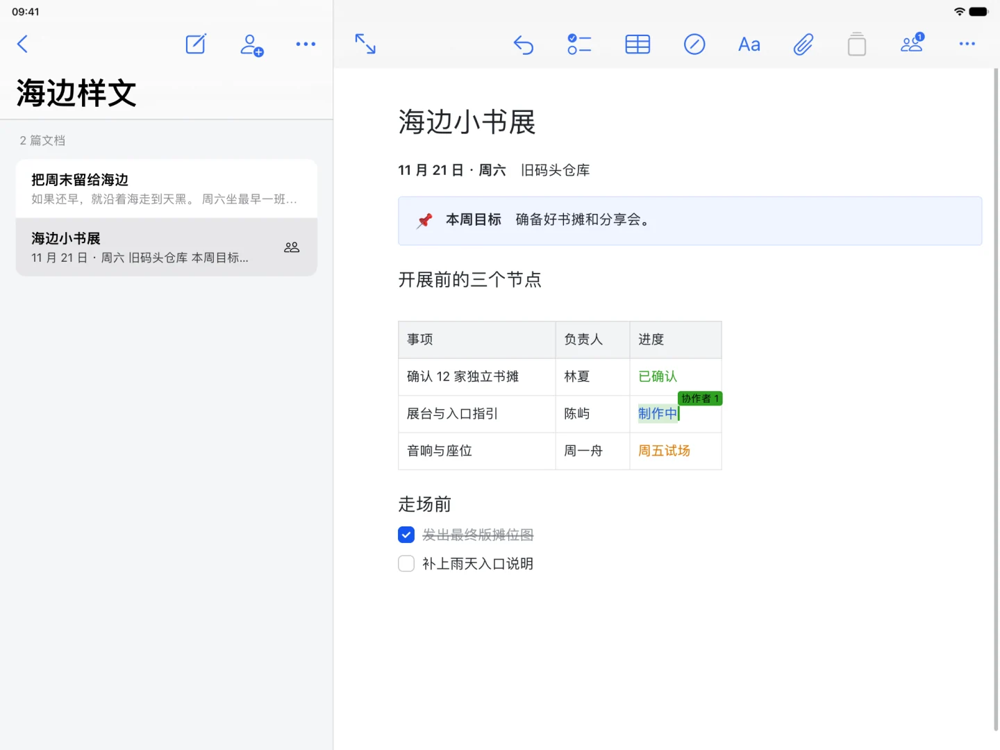
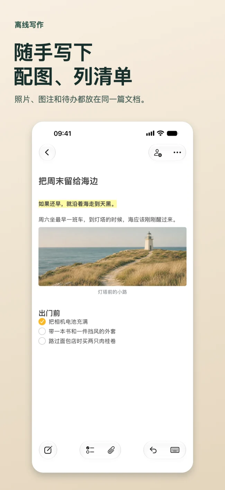

# 飞记 · Fei Notes

适用于 Mac、iPhone 和 iPad 的原生 Markdown 文档应用。飞书文档般顺手，离线也能独立使用。开启 iCloud，像用苹果备忘录一样换台设备接着写，也能邀请他人一起编辑，实时看到彼此的改动。

[官网](https://feinotes.app/) · [TestFlight 体验](https://feinotes.app/#testflight) · [支持](https://feinotes.app/support/) · [English](README.md)


- **本机文档。** 离线写作，支持文件夹、全文搜索、回收站和整库备份与恢复。
- **按需开启 iCloud。** 在自己的 Mac、iPhone 和 iPad 之间同步文档、目录和附件，离线修改同段不同位置后可自动合并。
- **多人实时协作。** 通过 iCloud 共享单篇文档或整个文件夹，邀请他人查看或一起编辑，在应用内管理访问权限，实时看到彼此的改动。受邀者需要 iCloud 账号。
- **Markdown 与丰富内容。** 原生块编辑器支持标题、清单、代码、表格、图片和附件。
- **界面风格与文档主题。** 界面可选飞书或备忘录风格，文档可单独选择飞书、备忘录、Craft、Notion 或 Obsidian 主题。
- **画板。** 在文档中插入 Excalidraw 绘图，或新建独立画板，支持本地历史与整库备份。
- **从 Quiet.md 导入。** 在文档库设置中选择原文档库，将内容复制到飞记。

<details>
<summary>查看 iPad 和 iPhone 截图</summary>





</details>

查看 Markdown 示例文档。[海边小书展](website/documents/feishu/zh/book-fair.md) · [把周末留给海边](website/documents/notes/zh/coastal-note.md)

## 体验

macOS 分发包同时包含 Apple 芯片和 Intel 架构，要求 macOS 14 或更高版本。Intel 已纳入编译与打包，尚未经 Intel 真机验证。在官网的 TestFlight 区域加入测试，官网显示当前分发与审核状态。

iPhone 版要求 iOS 17 或更高版本，iPad 版要求 iPadOS 17 或更高版本。官网分别显示 Mac 端与移动端 TestFlight 的开放状态。移动端构建说明见 [packaging/ios/README.md](packaging/ios/README.md)。

## 开发与来源

源码公开，可在适用许可范围内自行构建用于个人非商业用途：

```sh
cargo build --release --locked
```

开发说明以英文为主，见 [CONTRIBUTING.md](CONTRIBUTING.md) / [Fei Notes additions](docs/FEINOTES-CONTRIBUTING.md)、[AGENTS.md](AGENTS.md) / [Fei Notes rules](docs/FEINOTES-AGENTS.md)、[维护流程](docs/MAINTENANCE.md)和[Apple 发布流程](docs/APPLE-RELEASE.md)。

飞记基于 [Quiet.md](https://github.com/s1dashu/quiet-md)。上游代码保留 [MIT 许可](LICENSE)。清单中独立原创的飞记模块以 [PolyForm Noncommercial 1.0.0](LICENSE-FEINOTES.md) 提供源码，保留商业使用权，商业用途需另行取得许可；这不改变上游 MIT 代码已有的使用权限。文件范围见 [LICENSES.md](LICENSES.md)，第三方声明见 [THIRD_PARTY.md](THIRD_PARTY.md)。
